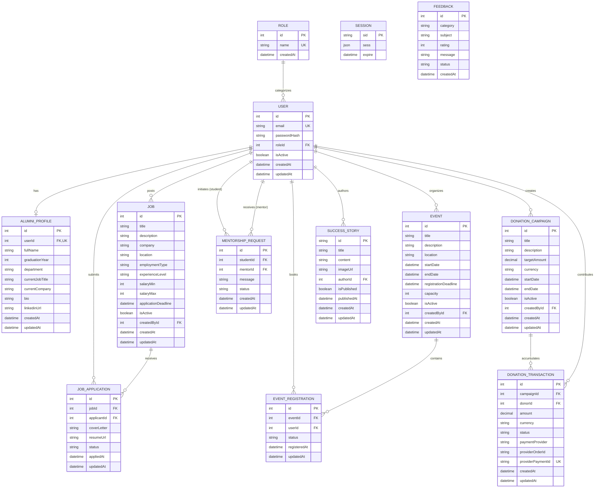

# Data Engineering & ER Modelling Architecture
## Alumni Association Platform — Comprehensive Data Model Specification

---

## 1. Executive Summary & System Overview

The **Alumni Association Platform** is an enterprise-grade digital ecosystem designed to connect graduates, current students, faculty, and administrative staff across a higher education institution.

From a **Data Engineering (DE)** perspective, the data layer must fulfill rigorous operational demands:
* **High Read Concurrency:** High-throughput queries on the alumni directory, career opportunities, event rosters, and published success stories.
* **Transactional Integrity (ACID):** Critical financial transactions (donations processed via payment gateways), strict uniqueness constraints on composite keys (preventing double event registrations or duplicate job applications), and atomic session states.
* **Role-Based Access Control (RBAC):** Strict security perimeter separating `STUDENT`, `ALUMNI`, and `ADMIN` actions enforced via referential constraints at the database level.
* **Zero Redundancy & Normalization:** Strictly normalized relational schema up to **Boyce-Codd Normal Form (BCNF)** for operational records, with selective indexed caching for high-speed querying.

The persistence architecture is implemented on **PostgreSQL** managed through **Prisma ORM** (`server/prisma/schema.prisma`), providing typed migrations, referential actions, and deterministic schema synchronization.

---

## 2. Conceptual Data Model

The conceptual model categorizes system capabilities into six functional domains:

```
  ┌────────────────────────────────────────────────────────────────────────┐
  │                           SECURITY & IDENTITY                          │
  │           Role (1) ────< User (N) >──── (1) AlumniProfile              │
  └──────────────────┬──────────────────────┬──────────────────────────────┘
                     │                      │
       ┌─────────────┴────────────┐   ┌─────┴────────────────────────────┐
       ▼                          ▼   ▼                                  ▼
┌──────────────┐          ┌──────────────┐                       ┌──────────────┐
│ CAREER / JOBS│          │  MENTORSHIP  │                       │    EVENTS    │
│  Job (1)     │          │  Student (N) │                       │  Event (1)   │
│   │          │          │   │ (Request)│                       │   │          │
│   ▼ (1:N)    │          │   ▼          │                       │   ▼ (1:N)    │
│  Application │          │  Mentor (N)  │                       │ Registration │
└──────────────┘          └──────────────┘                       └──────────────┘
       ▲                                                                 ▲
       │                  ┌──────────────────────┐                       │
       └──────────────────┤ GIVING & ENGAGEMENT  ├───────────────────────┘
                          │ Campaign (1)─<Tx (N) │
                          │ SuccessStory (N)     │
                          │ Feedback (Independent│
                          └──────────────────────┘
```

1. **Identity & Access Management (IAM):** Core authentication (`User`), role classification (`Role`), session persistence (`Session`), and comprehensive profile attributes (`AlumniProfile`).
2. **Career & Placement Network:** Job publication by verified alumni/admins (`Job`) and distinct candidate submissions (`JobApplication`).
3. **Events & Reunions:** Event scheduling and capacity management (`Event`) with individual attendee booking states (`EventRegistration`).
4. **Mentorship & Guidance:** Bilateral student-to-alumnus mentorship pairing requests and status lifecycles (`MentorshipRequest`).
5. **Giving & Philanthropy:** Institutional fundraising initiatives (`DonationCampaign`) linked to payment gateway transaction ledgers (`DonationTransaction`).
6. **Community Voice & Impact:** Curated public editorial features (`SuccessStory`) and structured feedback channels (`Feedback`).

---

## 3. Entity-Relationship Diagram (ERD)

The complete entity-relationship model represents all 13 database entities and their relational cardinalities:



---

## 4. Comprehensive Data Dictionary & Schema Catalog

### 4.1 Table: `Role`
Defines authorization security roles for RBAC.

| Column | Type | Nullable | Key | Default | Description |
|---|---|---|---|---|---|
| `id` | `INTEGER` | No | PK | `autoincrement()` | Unique role surrogate identifier |
| `name` | `VARCHAR(50)` | No | UK | None | Unique role designation (`ADMIN`, `ALUMNI`, `STUDENT`) |
| `createdAt` | `TIMESTAMPTZ` | No | — | `CURRENT_TIMESTAMP` | Audit creation timestamp |

### 4.2 Table: `User`
Central identity authentication record.

| Column | Type | Nullable | Key | Default | Description |
|---|---|---|---|---|---|
| `id` | `INTEGER` | No | PK | `autoincrement()` | Unique user surrogate identifier |
| `email` | `VARCHAR(255)` | No | UK | None | Sanitized lowercase unique login email address |
| `passwordHash` | `VARCHAR(255)` | No | — | None | Cryptographic bcrypt password hash (salt rounds = 10) |
| `roleId` | `INTEGER` | No | FK | None | References `Role(id)` with `ON DELETE RESTRICT` |
| `isActive` | `BOOLEAN` | No | — | `true` | Account active state for administrative deactivation |
| `createdAt` | `TIMESTAMPTZ` | No | — | `CURRENT_TIMESTAMP` | Account registration timestamp |
| `updatedAt` | `TIMESTAMPTZ` | No | — | `CURRENT_TIMESTAMP` | Account modification timestamp |

### 4.3 Table: `AlumniProfile`
Extended professional and academic metadata for verified alumni and users.

| Column | Type | Nullable | Key | Default | Description |
|---|---|---|---|---|---|
| `id` | `INTEGER` | No | PK | `autoincrement()` | Profile identifier |
| `userId` | `INTEGER` | No | FK, UK | None | Unique 1:1 foreign key referencing `User(id)` (`ON DELETE CASCADE`) |
| `fullName` | `VARCHAR(150)` | No | — | None | Full legal / professional name |
| `graduationYear`| `INTEGER` | Yes | Index | `NULL` | Graduation cohort year (1950–2100) |
| `department` | `VARCHAR(100)` | Yes | — | `NULL` | Field of study / engineering discipline |
| `currentJobTitle`| `VARCHAR(150)`| Yes | — | `NULL` | Current professional designation |
| `currentCompany` | `VARCHAR(150)`| Yes | Index | `NULL` | Current employer / organization |
| `bio` | `TEXT` | Yes | — | `NULL` | Detailed biographical summary |
| `linkedinUrl` | `VARCHAR(255)` | Yes | — | `NULL` | Verified LinkedIn profile URL |
| `createdAt` | `TIMESTAMPTZ` | No | — | `CURRENT_TIMESTAMP` | Profile creation timestamp |
| `updatedAt` | `TIMESTAMPTZ` | No | — | `CURRENT_TIMESTAMP` | Profile update timestamp |

### 4.4 Table: `Job`
Job and internship listings posted by alumni or administrators.

| Column | Type | Nullable | Key | Default | Description |
|---|---|---|---|---|---|
| `id` | `INTEGER` | No | PK | `autoincrement()` | Unique job posting identifier |
| `title` | `VARCHAR(200)` | No | — | None | Role title |
| `description` | `TEXT` | No | — | None | Full job description and requirements |
| `company` | `VARCHAR(150)` | No | — | None | Hiring company / organization |
| `location` | `VARCHAR(150)` | Yes | — | `NULL` | Office city or 'Remote' |
| `employmentType`| `VARCHAR(50)` | No | — | None | `Full-time`, `Part-time`, `Internship`, `Contract` |
| `experienceLevel`| `VARCHAR(50)`| Yes | — | `NULL` | `Entry-level`, `Mid-level`, `Senior`, `Lead` |
| `salaryMin` | `INTEGER` | Yes | — | `NULL` | Minimum salary bound (INR) |
| `salaryMax` | `INTEGER` | Yes | — | `NULL` | Maximum salary bound (INR) |
| `applicationDeadline`| `TIMESTAMPTZ`| Yes | — | `NULL` | Closing date for applications |
| `isActive` | `BOOLEAN` | No | Index | `true` | Visibility status of listing |
| `createdById` | `INTEGER` | No | FK | None | References `User(id)` (`ON DELETE RESTRICT`) |
| `createdAt` | `TIMESTAMPTZ` | No | — | `CURRENT_TIMESTAMP` | Listing creation timestamp |
| `updatedAt` | `TIMESTAMPTZ` | No | — | `CURRENT_TIMESTAMP` | Listing update timestamp |

### 4.5 Table: `JobApplication`
Application records submitted by students or alumni candidates.

| Column | Type | Nullable | Key | Default | Description |
|---|---|---|---|---|---|
| `id` | `INTEGER` | No | PK | `autoincrement()` | Application identifier |
| `jobId` | `INTEGER` | No | FK, UK(1) | None | References `Job(id)` (`ON DELETE CASCADE`) |
| `applicantId` | `INTEGER` | No | FK, UK(2) | None | References `User(id)` (`ON DELETE CASCADE`) |
| `coverLetter` | `TEXT` | Yes | — | `NULL` | Cover letter / candidate statement |
| `resumeUrl` | `VARCHAR(255)` | Yes | — | `NULL` | Direct URL to candidate resume document |
| `status` | `VARCHAR(50)` | No | Index | `'PENDING'` | Status: `PENDING`, `REVIEWED`, `ACCEPTED`, `REJECTED` |
| `appliedAt` | `TIMESTAMPTZ` | No | — | `CURRENT_TIMESTAMP` | Timestamp of submission |
| `updatedAt` | `TIMESTAMPTZ` | No | — | `CURRENT_TIMESTAMP` | Timestamp of status review |

*Composite Unique Constraint:* `[jobId, applicantId]` strictly prevents duplicate submissions for the same position by the same applicant.

### 4.6 Table: `Event`
Institutional reunions, webinars, tech symposiums, and gatherings.

| Column | Type | Nullable | Key | Default | Description |
|---|---|---|---|---|---|
| `id` | `INTEGER` | No | PK | `autoincrement()` | Event identifier |
| `title` | `VARCHAR(200)` | No | — | None | Event headline |
| `description` | `TEXT` | No | — | None | Full schedule and agenda |
| `location` | `VARCHAR(200)` | Yes | — | `NULL` | Physical hall / campus venue or webinar link |
| `startDate` | `TIMESTAMPTZ` | No | Index | None | Event commencement datetime |
| `endDate` | `TIMESTAMPTZ` | No | — | None | Event conclusion datetime |
| `registrationDeadline`| `TIMESTAMPTZ`| Yes | — | `NULL` | Cut-off timestamp for registrations |
| `capacity` | `INTEGER` | Yes | — | `NULL` | Maximum attendee headcount threshold |
| `isActive` | `BOOLEAN` | No | Index | `true` | Event status flag |
| `createdById` | `INTEGER` | No | FK | None | References `User(id)` (`ON DELETE RESTRICT`) |
| `createdAt` | `TIMESTAMPTZ` | No | — | `CURRENT_TIMESTAMP` | Creation timestamp |
| `updatedAt` | `TIMESTAMPTZ` | No | — | `CURRENT_TIMESTAMP` | Last update timestamp |

### 4.7 Table: `EventRegistration`
Attendee bookings for institutional events.

| Column | Type | Nullable | Key | Default | Description |
|---|---|---|---|---|---|
| `id` | `INTEGER` | No | PK | `autoincrement()` | Registration identifier |
| `eventId` | `INTEGER` | No | FK, UK(1) | None | References `Event(id)` (`ON DELETE RESTRICT`) |
| `userId` | `INTEGER` | No | FK, UK(2) | None | References `User(id)` (`ON DELETE CASCADE`) |
| `status` | `VARCHAR(50)` | No | Index | `'REGISTERED'`| Booking status: `REGISTERED`, `CANCELLED`, `ATTENDED` |
| `registeredAt` | `TIMESTAMPTZ` | No | — | `CURRENT_TIMESTAMP` | Registration timestamp |
| `updatedAt` | `TIMESTAMPTZ` | No | — | `CURRENT_TIMESTAMP` | Status change timestamp |

*Composite Unique Constraint:* `[eventId, userId]` guarantees an attendee cannot reserve duplicate seats for an identical event.

### 4.8 Table: `MentorshipRequest`
Pairing requests initiated by students seeking alumni career coaching.

| Column | Type | Nullable | Key | Default | Description |
|---|---|---|---|---|---|
| `id` | `INTEGER` | No | PK | `autoincrement()` | Request identifier |
| `studentId` | `INTEGER` | No | FK, Index | None | References `User(id)` of student (`ON DELETE CASCADE`) |
| `mentorId` | `INTEGER` | No | FK, Index | None | References `User(id)` of mentor (`ON DELETE CASCADE`) |
| `message` | `TEXT` | Yes | — | `NULL` | Initial mentorship inquiry / goals |
| `status` | `VARCHAR(50)` | No | Index | `'PENDING'` | Status: `PENDING`, `ACCEPTED`, `REJECTED`, `COMPLETED` |
| `createdAt` | `TIMESTAMPTZ` | No | — | `CURRENT_TIMESTAMP` | Submission timestamp |
| `updatedAt` | `TIMESTAMPTZ` | No | — | `CURRENT_TIMESTAMP` | Last update timestamp |

### 4.9 Table: `DonationCampaign`
Institutional giving initiatives and targeted fundraising campaigns.

| Column | Type | Nullable | Key | Default | Description |
|---|---|---|---|---|---|
| `id` | `INTEGER` | No | PK | `autoincrement()` | Campaign identifier |
| `title` | `VARCHAR(200)` | No | — | None | Campaign title |
| `description` | `TEXT` | No | — | None | Goal description and capital allocation details |
| `targetAmount` | `DECIMAL(14,2)`| No | — | None | Total target goal amount (INR) |
| `currency` | `VARCHAR(10)` | No | — | `'INR'` | ISO Currency Code |
| `startDate` | `TIMESTAMPTZ` | No | — | None | Campaign launch date |
| `endDate` | `TIMESTAMPTZ` | Yes | — | `NULL` | Campaign conclusion date |
| `isActive` | `BOOLEAN` | No | Index | `true` | Active campaign flag |
| `createdById` | `INTEGER` | No | FK | None | References `User(id)` (`ON DELETE RESTRICT`) |
| `createdAt` | `TIMESTAMPTZ` | No | — | `CURRENT_TIMESTAMP` | Campaign creation timestamp |
| `updatedAt` | `TIMESTAMPTZ` | No | — | `CURRENT_TIMESTAMP` | Last update timestamp |

### 4.10 Table: `DonationTransaction`
Cryptographically verified financial ledger of alumni contributions.

| Column | Type | Nullable | Key | Default | Description |
|---|---|---|---|---|---|
| `id` | `INTEGER` | No | PK | `autoincrement()` | Transaction record ID |
| `campaignId` | `INTEGER` | No | FK, Index | None | References `DonationCampaign(id)` (`ON DELETE RESTRICT`)|
| `donorId` | `INTEGER` | No | FK, Index | None | References `User(id)` (`ON DELETE RESTRICT`) |
| `amount` | `DECIMAL(14,2)`| No | — | None | Financial value contributed |
| `currency` | `VARCHAR(10)` | No | — | `'INR'` | ISO Currency Code |
| `status` | `VARCHAR(50)` | No | Index | `'PENDING'` | Status: `PENDING`, `COMPLETED`, `FAILED`, `REFUNDED` |
| `paymentProvider`| `VARCHAR(50)`| Yes | — | `NULL` | Payment provider (`RAZORPAY`) |
| `providerOrderId`| `VARCHAR(100)`| Yes | — | `NULL` | Razorpay order ID |
| `providerPaymentId`|`VARCHAR(100)`| Yes| UK | `NULL` | Razorpay payment ID (Unique constraint) |
| `createdAt` | `TIMESTAMPTZ` | No | Index | `CURRENT_TIMESTAMP`| Transaction initiation timestamp |
| `updatedAt` | `TIMESTAMPTZ` | No | — | `CURRENT_TIMESTAMP`| Verification / resolution timestamp |

### 4.11 Table: `SuccessStory`
Curated editorial spotlights showcasing alumni career achievements.

| Column | Type | Nullable | Key | Default | Description |
|---|---|---|---|---|---|
| `id` | `UUID` | No | PK | `uuid()` | Globally unique story identifier |
| `title` | `VARCHAR(200)` | No | — | None | Story headline |
| `content` | `TEXT` | No | — | None | Full article narrative and insights |
| `imageUrl` | `VARCHAR(255)` | Yes | — | `NULL` | Featured image URL |
| `authorId` | `INTEGER` | No | FK, Index | None | References `User(id)` (`ON DELETE RESTRICT`) |
| `isPublished` | `BOOLEAN` | No | Index | `false` | Editorial moderation status |
| `publishedAt` | `TIMESTAMPTZ` | Yes | — | `NULL` | Public approval timestamp |
| `createdAt` | `TIMESTAMPTZ` | No | Index | `CURRENT_TIMESTAMP` | Draft submission timestamp |
| `updatedAt` | `TIMESTAMPTZ` | No | — | `CURRENT_TIMESTAMP` | Last update timestamp |

### 4.12 Table: `Feedback`
Independent institutional feedback and survey responses.

| Column | Type | Nullable | Key | Default | Description |
|---|---|---|---|---|---|
| `id` | `INTEGER` | No | PK | `autoincrement()` | Feedback identifier |
| `category` | `VARCHAR(50)` | No | — | None | Category (`GENERAL`, `CURRICULUM`, `CAMPUS`, etc.) |
| `subject` | `VARCHAR(150)` | No | — | None | Brief subject line |
| `rating` | `INTEGER` | No | — | None | Experience rating (1–5) |
| `message` | `TEXT` | No | — | None | Detailed message body |
| `status` | `VARCHAR(50)` | No | — | `'PENDING'` | Moderation status |
| `createdAt` | `TIMESTAMPTZ` | No | — | `CURRENT_TIMESTAMP` | Submission timestamp |

### 4.13 Table: `session`
PostgreSQL-backed session table managed by `connect-pg-simple`.

| Column | Type | Nullable | Key | Description |
|---|---|---|---|---|
| `sid` | `VARCHAR` | No | PK | Express session cookie ID |
| `sess` | `JSON` | No | — | Serialized session object containing `userId` and `role` |
| `expire` | `TIMESTAMP(6)` | No | Index | Session expiration cutoff |

---

## 5. Referential Integrity & Cascade Strategies

Referential actions are designed to protect audit trails while enabling clean user deletion:

| Parent Entity | Child Entity | Foreign Key | Cascade Action | Engineering Justification |
|---|---|---|---|---|
| `Role` | `User` | `roleId` | `ON DELETE RESTRICT` | Prevents deleting system roles while active users are assigned. |
| `User` | `AlumniProfile` | `userId` | `ON DELETE CASCADE` | Profile is strictly owned by the User; deleting a user drops their profile. |
| `User` | `JobApplication` | `applicantId`| `ON DELETE CASCADE` | Applications are candidate-specific and purged with candidate account. |
| `Job` | `JobApplication` | `jobId` | `ON DELETE CASCADE` | Deleting a job posting removes all dependent candidate applications. |
| `User` | `Job` | `createdById` | `ON DELETE RESTRICT` | Prevents deleting an alumnus account that currently owns active job postings. |
| `Event` | `EventRegistration`| `eventId` | `ON DELETE RESTRICT` | Protects event booking history; active events with attendees cannot be wiped. |
| `User` | `EventRegistration`| `userId` | `ON DELETE CASCADE` | An individual user can cancel/delete account without corrupting event records. |
| `User` | `MentorshipRequest`| `studentId`/`mentorId`| `ON DELETE CASCADE`| Mentorship requests are bilateral; account closure cleans orphaned inquiries. |
| `DonationCampaign`| `DonationTransaction`| `campaignId`| `ON DELETE RESTRICT`| **Financial Audit Compliance:** Campaigns with donation ledgers cannot be deleted. |
| `User` | `DonationTransaction`| `donorId` | `ON DELETE RESTRICT`| **Statutory Record Keeping:** Financial ledgers cannot orphan donor identity. |
| `User` | `SuccessStory` | `authorId` | `ON DELETE RESTRICT`| Published institutional stories must preserve author attribution. |

---

## 6. Normalization Analysis & Proofs

The relational model strictly satisfies **Third Normal Form (3NF)** and **Boyce-Codd Normal Form (BCNF)** across all operational tables.

### 6.1 First Normal Form (1NF)
* Every table contains a unique primary key (`id` or `sid`).
* All attributes contain strictly atomic values. Lists, tags, and composite fields are handled through first-class tables (`JobApplication`, `EventRegistration`) rather than comma-separated strings or arrays.
* No repeating groups exist in any entity.

### 6.2 Second Normal Form (2NF)
* The schema is in 1NF.
* All non-key attributes are fully functionally dependent on the entire primary key.
* In tables with composite candidate keys (e.g. `JobApplication` with candidate key `{jobId, applicantId}`):
  * `coverLetter`, `resumeUrl`, `status`, `appliedAt` depend on **both** the specific job and the specific applicant together.
  * No partial dependency exists on just `jobId` or just `applicantId`.

### 6.3 Third Normal Form (3NF)
* The schema is in 2NF.
* No transitive functional dependencies exist ($X \to Y \to Z$ where $Z$ depends on non-key $Y$).
* Example: `AlumniProfile` contains `currentCompany` as a plain string, rather than joining to a dependent `Company` table with company address, avoiding transitive dependency. `User` contains `roleId` referencing `Role(id)` rather than storing redundant role descriptions in the user record.

### 6.4 Boyce-Codd Normal Form (BCNF)
* For every non-trivial functional dependency $X \to Y$, $X$ is a superkey.
* In `DonationTransaction`:
  * Candidate keys: `{id}`, `{providerPaymentId}`.
  * All attributes depend on the primary surrogate `id` or the external unique provider payment token `providerPaymentId`. Both are valid superkeys.

---

## 7. Indexing Architecture & Query Optimization

To sustain sub-millisecond response times under production load, explicit B-Tree indexes are deployed on high-cardinality filters:

```sql
-- High-concurrency directory discovery:
CREATE INDEX idx_alumni_profile_grad_year ON "AlumniProfile" ("graduationYear");
CREATE INDEX idx_alumni_profile_company ON "AlumniProfile" ("currentCompany");

-- Job portal active listings:
CREATE INDEX idx_job_is_active ON "Job" ("isActive");
CREATE INDEX idx_job_created_by ON "Job" ("createdById");
CREATE INDEX idx_job_application_status ON "JobApplication" ("status");

-- Event calendar queries:
CREATE INDEX idx_event_start_date ON "Event" ("startDate");
CREATE INDEX idx_event_is_active ON "Event" ("isActive");

-- Financial transaction auditing:
CREATE INDEX idx_donation_tx_campaign ON "DonationTransaction" ("campaignId");
CREATE INDEX idx_donation_tx_donor ON "DonationTransaction" ("donorId");
CREATE INDEX idx_donation_tx_created_at ON "DonationTransaction" ("createdAt");

-- Editorial publishing workflow:
CREATE INDEX idx_story_published ON "SuccessStory" ("isPublished");
CREATE INDEX idx_story_created_at ON "SuccessStory" ("createdAt");

-- Session expiration eviction:
CREATE INDEX "IDX_session_expire" ON "session" ("expire");
```

---

## 8. Summary of Data Engineering Metrics

* **Total Managed Entities:** 13
* **Primary Key Strategies:** Auto-incrementing 32-bit Integers (`Int`), UUID v4 (`String`), and String Session Hash (`VarChar`).
* **Foreign Key Constraints:** 15 explicit relations mapped with referential actions.
* **Temporal Auditing:** ISO 8601 Timestamps (`createdAt`, `updatedAt`) on 100% of core entities.
* **Storage Engine:** PostgreSQL with Prisma Schema synchronization.
