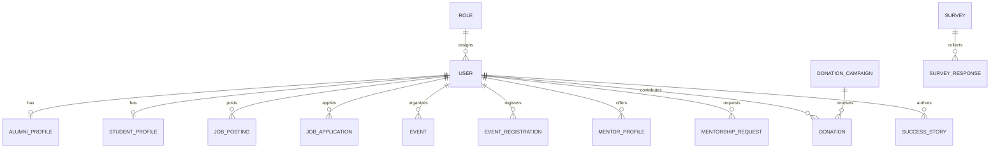

# Database and API Design — Alumni Association Platform

**Repository:** Government Engineering College (GEC) — Alumni Association Platform  
**Author:** Person 3 (Feature Developer)  
**Collaborators:** Aniruddha Dwivedi (Lead/Backend), Person 2 (Frontend/Shared Layout)  
**Status:** Living Documentation (Coordinated with current codebase and upcoming sprint roadmaps)

---

## 1. Overview and Architecture Principles

This document specifies the database architecture, entity relationships, REST API conventions, validation schemas, and security contracts for the Alumni Association Platform.

The platform architecture follows a clear separation of concerns:
* **Frontend:** React 19 + Vite SPA, styled with Tailwind CSS, routed via React Router.
* **Backend:** Node.js + Express REST API.
* **Database & ORM:** PostgreSQL managed via Prisma ORM with migrations.
* **Security & Auth:** HTTP-only cookie-based session management / tokens, passwords hashed with `bcrypt`, RBAC on protected routes.
* **Validation:** Runtime request payload validation using Zod.

---

## 2. Database Schema & Entity Relationships

The database architecture is designed in Prisma ORM (`server/prisma/schema.prisma`).

### 2.1 Implemented Core Schema (Current Active Database)

The current PostgreSQL migration (`20261026100326_init_core_models`) establishes foundational RBAC and member profile storage:

```prisma
datasource db {
  provider = "postgresql"
  url      = env("DATABASE_URL")
}

generator client {
  provider = "prisma-client-js"
}

model Role {
  id        Int      @id @default(autoincrement())
  name      String   @unique
  createdAt DateTime @default(now())
  users     User[]
}

model User {
  id            Int             @id @default(autoincrement())
  email         String          @unique
  passwordHash  String
  roleId        Int
  isActive      Boolean         @default(true)
  createdAt     DateTime        @default(now())
  updatedAt     DateTime        @updatedAt
  role          Role            @relation(fields: [roleId], references: [id], onDelete: Restrict)
  alumniProfile AlumniProfile?
}

model AlumniProfile {
  id              Int      @id @default(autoincrement())
  userId          Int      @unique
  fullName        String
  graduationYear  Int?
  department      String?
  currentJobTitle String?
  currentCompany  String?
  bio             String?
  linkedinUrl     String?
  createdAt       DateTime @default(now())
  updatedAt       DateTime @updatedAt
  user            User     @relation(fields: [userId], references: [id], onDelete: Cascade)
}
```

#### Implemented Entity Details:
1. **`Role` Entity:**
   * **Primary Key:** `id` (`Int`, autoincrement)
   * **Attributes:** `name` (`String`, unique, e.g. `'ADMIN'`, `'ALUMNI'`, `'STUDENT'`), `createdAt` (`DateTime`, default `now()`)
   * **Relationships:** One-to-Many with `User`.
   * **Constraint / Referential Action:** `onDelete: Restrict` prevents accidental cascading role deletions when users are assigned.

2. **`User` Entity:**
   * **Primary Key:** `id` (`Int`, autoincrement)
   * **Attributes:** `email` (`String`, unique), `passwordHash` (`String`), `roleId` (`Int`, foreign key referencing `Role.id`), `isActive` (`Boolean`, default `true`), `createdAt`, `updatedAt`.
   * **Relationships:** Many-to-One with `Role`, One-to-One optional with `AlumniProfile`.
   * **Indexes:** Unique index on `email`.

3. **`AlumniProfile` Entity:**
   * **Primary Key:** `id` (`Int`, autoincrement)
   * **Foreign Key:** `userId` (`Int`, unique foreign key referencing `User.id`).
   * **Attributes:** `fullName` (`String`), `graduationYear` (`Int`, optional), `department` (`String`, optional), `currentJobTitle` (`String`, optional), `currentCompany` (`String`, optional), `bio` (`String`, optional), `linkedinUrl` (`String`, optional), `createdAt`, `updatedAt`.
   * **Relationships:** One-to-One with `User` (`onDelete: Cascade`).

---

### 2.2 Proposed Extended Schema (Pending Aniruddha's Approval)

To support the complete functional requirements (Events, Mentorship, Jobs, Applications, Donations, Stories, Surveys, Verification), the following schema additions are proposed.

> [!NOTE]
> The models below represent proposed contracts aligned with project requirements. They are pending review and migration approval from Aniruddha.



#### Proposed Models Specification:

1. **`StudentProfile` (1:1 with `User`):**
   * `id` (`Int`, PK), `userId` (`Int`, unique FK), `enrollmentNumber` (`String`, unique), `currentYear` (`Int`), `department` (`String`), `resumeUrl` (`String?`), `skills` (`String[]`), `createdAt`, `updatedAt`.

2. **`VerificationStatus` & Institutional Verification:**
   * Propose adding an enum `AccountStatus { PENDING, VERIFIED, REJECTED }` to `User` or `AlumniProfile` to enforce alumni verification before granting full directory access.

3. **`Event` & `EventRegistration` (1:N and M:N):**
   * **`Event`:** `id` (`Int`, PK), `title` (`String`), `description` (`String`), `location` (`String`), `isVirtual` (`Boolean`), `meetingUrl` (`String?`), `eventDate` (`DateTime`), `capacity` (`Int?`), `organizerId` (`Int`, FK to `User`), `createdAt`, `updatedAt`.
   * **`EventRegistration`:** `id` (`Int`, PK), `eventId` (`Int`, FK), `userId` (`Int`, FK), `status` (`Enum: REGISTERED, ATTENDED, CANCELLED`), `registeredAt` (`DateTime`).
   * **Constraint:** Unique composite `[eventId, userId]`.

4. **`Mentorship` Models:**
   * **`MentorProfile`:** `id` (`Int`, PK), `userId` (`Int`, unique FK), `expertiseAreas` (`String[]`), `maxMentees` (`Int`, default 3), `isAvailable` (`Boolean`), `linkedinUrl` (`String?`).
   * **`MentorshipRequest`:** `id` (`Int`, PK), `mentorId` (`Int`, FK to `User`), `menteeId` (`Int`, FK to `User`), `topic` (`String`), `message` (`String`), `status` (`Enum: PENDING, ACCEPTED, DECLINED, COMPLETED`), `createdAt`, `updatedAt`.

5. **`JobPosting` & `JobApplication`:**
   * **`JobPosting`:** `id` (`Int`, PK), `title` (`String`), `company` (`String`), `location` (`String`), `jobType` (`Enum: FULL_TIME, PART_TIME, INTERNSHIP, REMOTE`), `description` (`String`), `requirements` (`String`), `externalUrl` (`String?`), `postedById` (`Int`, FK to `User`), `isActive` (`Boolean`, default true), `deadline` (`DateTime?`), `createdAt`.
   * **`JobApplication`:** `id` (`Int`, PK), `jobId` (`Int`, FK), `applicantId` (`Int`, FK to `User`), `coverLetter` (`String?`), `resumeUrl` (`String`), `status` (`Enum: SUBMITTED, REVIEWED, SHORTLISTED, REJECTED`), `appliedAt` (`DateTime`).
   * **Constraint:** Unique composite `[jobId, applicantId]`.

6. **`DonationCampaign` & `Donation`:**
   * **`DonationCampaign`:** `id` (`Int`, PK), `title` (`String`), `goalAmount` (`Decimal`), `raisedAmount` (`Decimal`, default 0), `description` (`String`), `startDate` (`DateTime`), `endDate` (`DateTime?`), `isActive` (`Boolean`).
   * **`Donation`:** `id` (`Int`, PK), `campaignId` (`Int`, FK), `donorId` (`Int?`, optional FK for anonymous donors), `donorName` (`String`), `amount` (`Decimal`), `paymentStatus` (`Enum: PENDING, SUCCESSFUL, FAILED`), `transactionRef` (`String`, unique), `createdAt` (`DateTime`).

7. **`SuccessStory`:**
   * `id` (`Int`, PK), `authorId` (`Int`, FK to `User`), `title` (`String`), `content` (`String`), `imageUrl` (`String?`), `isApproved` (`Boolean`, default false), `createdAt`, `updatedAt`.

8. **`Survey` & `SurveyResponse`:**
   * **`Survey`:** `id` (`Int`, PK), `title` (`String`), `description` (`String`), `targetRole` (`String?`), `questions` (`Json`), `isActive` (`Boolean`).
   * **`SurveyResponse`:** `id` (`Int`, PK), `surveyId` (`Int`, FK), `respondentId` (`Int?`, FK), `answers` (`Json`), `submittedAt` (`DateTime`).

---

## 3. REST API Design & Conventions

### 3.1 Conventions
* **Base URL:** `/api/v1` (currently root mounted `/api` in `server/src/server.js`)
* **Transport:** HTTPS, JSON payloads for request and response.
* **Authentication:** HTTP-only secure cookie containing session/token (`access_token`).
* **Standard Response Envelope:**
  * Success:
    ```json
    {
      "success": true,
      "data": { ... },
      "message": "Optional human-readable confirmation message"
    }
    ```
  * Error:
    ```json
    {
      "success": false,
      "error": {
        "code": "BAD_REQUEST | UNAUTHORIZED | FORBIDDEN | NOT_FOUND | VALIDATION_ERROR | INTERNAL_ERROR",
        "message": "Descriptive error message",
        "details": [ ... ]
      }
    }
    ```

---

### 3.2 Implemented Endpoints (Current Server Implementation)

The server currently exposes the following baseline routes in `server/src/server.js`:

| Method | Endpoint | Purpose | Auth | Request Body | Response |
| :--- | :--- | :--- | :--- | :--- | :--- |
| `GET` | `/` | Service root identification | Public | None | `200 OK` `{ "message": "Alumni Association API Backend" }` |
| `GET` | `/api/health` | Service health status check | Public | None | `200 OK` `{ "status": "healthy", "service": "Alumni Association API" }` |

---

### 3.3 Proposed REST API Endpoints Specification

Below are the agreed endpoint contracts designed for subsequent implementation sprints:

#### A. Authentication & User Management
* **`POST /api/auth/register`**
  * **Purpose:** Create a new user account with role assignment (Student or Alumni).
  * **Auth:** Public.
  * **Validation (Zod):** `email` (valid email format), `password` (min 8 chars, 1 uppercase, 1 digit), `role` (`'STUDENT' | 'ALUMNI'`), `fullName` (min 2 chars).
  * **Response:** `201 Created` with created user details and pending status message.

* **`POST /api/auth/login`**
  * **Purpose:** Authenticate user and issue secure HTTP-only cookie.
  * **Auth:** Public.
  * **Validation (Zod):** `email` (string, email), `password` (string).
  * **Response:** `200 OK` with user profile summary; sets `Set-Cookie: session_token=...; HttpOnly; SameSite=Lax; Secure`.

* **`POST /api/auth/logout`**
  * **Purpose:** Invalidate session and clear auth cookies.
  * **Auth:** Authenticated.
  * **Response:** `200 OK` with cookie clearance header.

* **`GET /api/auth/me`**
  * **Purpose:** Return current authenticated user session and role.
  * **Auth:** Authenticated (Student, Alumni, Admin).
  * **Response:** `200 OK` `{ "success": true, "data": { "id": 1, "email": "alumni@gec.edu", "role": "ALUMNI", "profile": { ... } } }`.

#### B. Alumni Profiles & Directory
* **`GET /api/alumni`**
  * **Purpose:** Search and list verified alumni.
  * **Auth:** Authenticated (Student, Alumni, Admin).
  * **Query Params:** `query` (search name/company), `department`, `graduationYear`, `page` (default 1), `limit` (default 20).
  * **Response:** `200 OK` with paginated list of alumni profiles.

* **`GET /api/alumni/:id`**
  * **Purpose:** Retrieve specific alumni profile details.
  * **Auth:** Authenticated.
  * **Response:** `200 OK` with full profile.

* **`PUT /api/alumni/profile`**
  * **Purpose:** Update current alumni's profile.
  * **Auth:** Authenticated (`ALUMNI` only, user can only update own profile).
  * **Validation (Zod):** `fullName`, `graduationYear` (int 1960-currentYear), `department`, `currentJobTitle`, `currentCompany`, `bio`, `linkedinUrl` (valid URL format).
  * **Response:** `200 OK` with updated profile.

#### C. Events & Registration
* **`GET /api/events`**
  * **Purpose:** Fetch upcoming and past events.
  * **Auth:** Public / Authenticated.
  * **Query Params:** `filter` (`'upcoming' | 'past'`), `page`, `limit`.
  * **Response:** `200 OK` with list of events.

* **`POST /api/events`**
  * **Purpose:** Create a new event.
  * **Auth:** Admin only.
  * **Validation (Zod):** `title`, `description`, `eventDate` (ISO datetime), `location`, `isVirtual`, `capacity` (optional int).
  * **Response:** `201 Created`.

* **`POST /api/events/:id/register`**
  * **Purpose:** Register current user for an event.
  * **Auth:** Authenticated (Student, Alumni).
  * **Response:** `200 OK` `{ "success": true, "message": "Registered successfully" }`.

* **`DELETE /api/events/:id/register`**
  * **Purpose:** Cancel an existing registration.
  * **Auth:** Authenticated.
  * **Response:** `200 OK`.

#### D. Mentorship
* **`GET /api/mentors`**
  * **Purpose:** Browse available alumni mentors.
  * **Auth:** Authenticated (Student, Alumni).
  * **Query Params:** `expertiseArea`, `page`.
  * **Response:** `200 OK` with list of mentors.

* **`POST /api/mentorship/requests`**
  * **Purpose:** Send a mentorship connection request.
  * **Auth:** Student only.
  * **Validation (Zod):** `mentorId` (int), `topic` (string, min 5 chars), `message` (string, min 20 chars).
  * **Response:** `201 Created`.

* **`PATCH /api/mentorship/requests/:id`**
  * **Purpose:** Accept or decline a mentorship request.
  * **Auth:** Mentor (target alumni).
  * **Validation (Zod):** `status` (`'ACCEPTED' | 'DECLINED'`).
  * **Response:** `200 OK`.

#### E. Job Listings & Applications
* **`GET /api/jobs`**
  * **Purpose:** List active jobs and internships.
  * **Auth:** Authenticated (Student, Alumni, Admin).
  * **Query Params:** `jobType`, `department`, `page`, `limit`.
  * **Response:** `200 OK` with job listings.

* **`POST /api/jobs`**
  * **Purpose:** Post a new job or internship opportunity.
  * **Auth:** Alumni or Admin.
  * **Validation (Zod):** `title`, `company`, `location`, `jobType`, `description`, `requirements`, `deadline`.
  * **Response:** `201 Created`.

* **`POST /api/jobs/:id/apply`**
  * **Purpose:** Submit application for a job.
  * **Auth:** Student or Alumni.
  * **Validation (Zod):** `coverLetter` (optional string), `resumeUrl` (valid URL).
  * **Response:** `201 Created`.

#### F. Inquiries & Feedback (Public Contact)
* **`POST /api/contact`**
  * **Purpose:** Submit a public contact inquiry form.
  * **Auth:** Public.
  * **Validation (Zod):**
    ```javascript
    z.object({
      name: z.string().trim().min(2, "Name must be at least 2 characters"),
      email: z.string().trim().email("Please provide a valid email address"),
      subject: z.string().trim().min(3, "Subject must be at least 3 characters"),
      message: z.string().trim().min(10, "Message must be at least 10 characters")
    })
    ```
  * **Status:** Proposed endpoint. Frontend contact page uses client-side validation and graceful status handling until this endpoint is wired to nodemailer / inquiry database table.

---

## 4. Key Unresolved Decisions Requiring Aniruddha's Approval

To ensure consistent project delivery and avoid conflicting assumptions, the following architectural decisions are tracked for team coordination:

1. **Session Management Mechanism:**
   * *Option A:* Stateful server-side sessions backed by Redis / PostgreSQL table (`Session`).
   * *Option B:* Stateless JWTs issued inside HTTP-only secure cookies.
   * *Recommendation:* Stateless JWT in HTTP-only cookie for simplicity with horizontal scaling. **Pending Aniruddha's sign-off.**

2. **Alumni Verification Workflow:**
   * *Decision needed:* Should alumni registration require manual admin approval before login, or should users log in immediately with limited read-only permissions until verified via student ID / college registration number?
   * *Recommendation:* Immediate login with restricted unverified status, unlocked upon admin approval. **Pending confirmation.**

3. **Database Migration Strategy for Extended Models:**
   * *Decision needed:* When to execute `prisma migrate dev` for `Event`, `Mentorship`, `JobPosting`, and `Donation` models without interfering with in-flight branch merges.
   * *Agreement:* Schema extensions will be introduced in coordinated sprint commits.

4. **Public Contact Form Ingestion:**
   * *Decision needed:* Should contact submissions be logged to a `ContactInquiry` table in PostgreSQL, or dispatched directly via SMTP / SendGrid email alert to alumni cell administrators?
   * *Status:* Pending backend specification.
